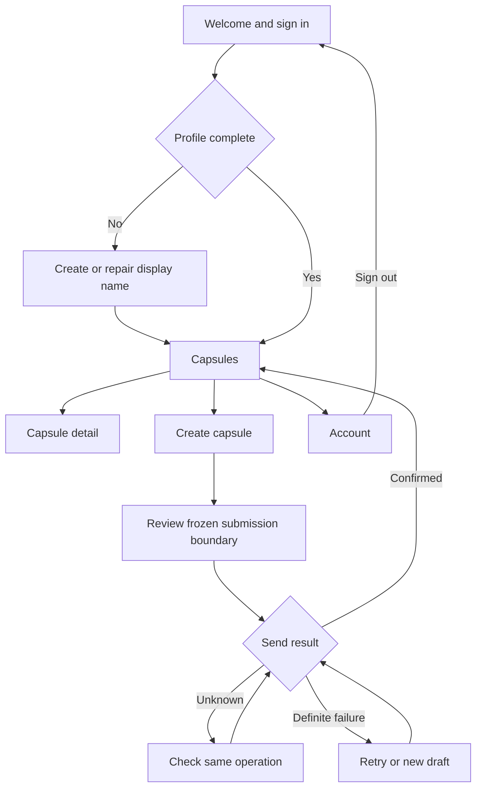

# TimeCapsule design document

**Team:** User F, User G, User J  
**Prepared:** 3 November 2026, Asia/Seoul  
**Contract source:** TimeCapsule Atlas `timecapsule`, revision **38**, instructions version **3**  
**Status:** Current behavior/design contracts finalized; Atlas-tracked implementation not started, acceptance not verified and tests not run in the captured source. The repository already contains a provisional UI scaffold; that does not establish completed requirements or acceptance.

TimeCapsule lets an authenticated user send a text/photo capsule to themselves or another registered account. The recipient sees safe metadata while its time, location or combined condition is unmet, and gains permanent access after a valid online unlock. This team document records screen flow, navigation and the Material 3 design system required by the professor's agent supplement.

**Status labels used here:** **Confirmed** means present in the current Atlas contract. **Proposed UI mapping** means a concrete documentation proposal for implementing that contract consistently; reconcile it with the checked-out Android resources and review it in the setup/UI PR before treating it as an adopted token. No proposed mapping changes MVP scope. See [SOURCE_REGISTER.md](docs/agent-tools/SOURCE_REGISTER.md) and [CURRENT_CONTRACT.md](docs/agent-tools/CURRENT_CONTRACT.md).

## 1 Product and platform boundaries

**Confirmed — FR-01–FR-12, ARC-01–ARC-07, DD-07/DD-11/DD-24.**

The MVP includes accounts, direct A→A/A→B delivery, text and/or one original JPEG/PNG photo, Time/Location/Both locks, separate Received/Sent lists, protected locked content, current-condition verification, recovery, best-effort local notifications and permanent re-view.

The approved target is **Kotlin native Android Views**. Material 3 describes the theme/components intended for that target. Preserve pinned dependencies until a reviewed application change explicitly requires changing them.

**Verified repository discrepancy:** the checkout inspected on 3 November 2026 contains a provisional Compose and Navigation Compose scaffold. That is an implementation fact, while Views remains the captured approved target. This document does not imply that Views screens already exist and does not migrate the application. Before further UI implementation, complete a separate reviewed reconciliation task against the current approved contract. See [REPOSITORY_STATUS.md](docs/agent-tools/REPOSITORY_STATUS.md) for the exact commit, paths, and evidence limits.

The app verifies on app-open, foreground resume, detail opening or explicit Retry. It installs no alarms, geofences, boot receivers, periodic polling, background location or FCM. A closed app is not promised an exact-time notification. The Sensors lecture does not create a requirement for an accelerometer or other unrelated sensor feature.

## 2 Screen flow and navigation

**Confirmed screen inventory — DD-07, DD-26–DD-28.** The proposed Back behavior below makes that inventory concrete without changing authorization or submission rules.

The diagram summarizes product navigation. It is not a class diagram or a claim about installed navigation libraries.

| Screen/state | Content and primary action | Navigation, Back and recovery | Contract |
|---|---|---|---|
| Welcome / Sign in | Email/password entry; register or sign in; explain invalid credentials separately from unavailable service. | After valid authentication, repair missing profile if needed, then load the active account. Sign-in cannot reveal another account's previous screen. | FR-01; DD-19, DD-26 |
| Registration / Profile repair | Required nonblank display name; idempotent creation of own UID profile after Auth succeeds. | Failed profile write offers Retry. Sending stays disabled until the profile exists. Do not duplicate Auth registration merely to repair the profile. | DD-03, DD-19 |
| Capsules | Received/Sent tabs; safe title, participant, lock condition and truthful status; empty/loading/error/stale states. | Card opens detail. Top-level navigation offers Capsules/Create/Account. Refresh discovers new received metadata. A→A appears in both tabs with one underlying ID. | FR-11; DD-07, DD-28 |
| Create — Content | Optional title, body, single-photo selector/preview; title visibility disclosure. | Next validates text and/or supported photo. Back/Next preserve the editable draft. A title alone is not valid content. | FR-02, FR-04; DD-04, DD-27 |
| Create — Recipient | Me or another user's exact UID; returned display name and explicit confirmation. | Every UID input edit clears earlier confirmation. Distinguish absent code from lookup unavailable. No searchable directory/friend list. | FR-03; DD-03, DD-19 |
| Create — Lock | Time, Location or Both; date/time with zone; confirmed map pin/current point. | Manual pin works without location permission. Current-location acquisition explains permission/settings errors. Display fixed 150 m radius. | FR-05–FR-07; DD-12, DD-13, DD-22 |
| Create — Review | Recipient code/name, disclosed title, chosen content and exact time/location condition. | Back edits only while DRAFT. Send validates and freezes one ID/snapshot before work starts. No new-ID restart while a previous result is unknown. | DD-14, DD-15, DD-27 |
| Sending / Outcome unknown | Progress or “We could not confirm the result”; Check status for the same operation. | Content/recipient/condition edits disabled. Leaving the screen does not abandon an operation or authorize a second send. Recovery restores honest state. | DD-15, DD-21 |
| Definite failure | Actual failure class; unchanged Retry, or abandon then create an edited new draft if unpublished failure is definite. | Retry keeps the original snapshot/ID; edited new draft uses a new ID. An absent server read alone is not definite failure. | DD-02, DD-21 |
| Locked recipient detail | Safe metadata; Waiting for time/location or Verification required; Retry and relevant Settings action. | No body/photo preview. Check online and obtain a fresh qualifying sample when needed. Back returns to the same list context. | FR-08–FR-10; DD-08, DD-28 |
| Confirmed content detail | Authorized text/photo; missing asset message if bytes cannot be loaded. | Once unlocked, leaving the location does not relock. Offline re-view requires the matching UID, confirmed marker and retained bytes. | FR-12; DD-06, DD-18 |
| Account | Own exact UID with Copy; own display name editing; Sign out. | Sign out clears old account screens/content and invalidates callbacks before a next session becomes visible. | FR-01; DD-19, DD-26 |
| Notification entry | Generic capsule-ready notification. | Route through authentication and confirmed detail state; a stale notification is never an authorization shortcut. | FR-10; DD-09, DD-24 |

### Create flow and Back behavior

The four steps are **Content → Recipient → Lock → Review**, with a persistent step label and clear Next/Back actions. The progress indicator communicates location in the flow; it does not permit bypassing required validation.

**Proposed UI mapping:** system Back moves to the preceding step while the draft is editable. Leaving Create with unsent edits shows a concise keep/discard choice consistent with actual draft retention. Do not promise drafts survive process death unless the implementation supports that promise. During SENDING/OUTCOME_UNKNOWN, Back may leave the status screen, but the operation remains frozen and recoverable; it does not become a new editable draft.

After confirmed success, open the safe Sent list/detail route. For self-send, purge raw composer display buffers and show the locked-recipient view. Viewing an A→B sender's content does not give B early recipient access.

### Locked detail and first unlock

A locked detail uses one clear status explanation and a relevant action:

| Situation | Example user-facing wording | Action |
|---|---|---|
| Time not reached | “This capsule opens after [date, time, zone].” | Retry when appropriate |
| Location not satisfied | “You are not within the required location yet.” | Check again |
| Location unclear | “We could not confirm your current location.” | Retry / location settings |
| Offline first verification | “Connect to check whether this capsule can open.” | Retry online |
| Notification denied | “You can still open eligible capsules in the app.” | Optional notification settings |
| Unlocked but missing local photo | “This photo is not available offline.” | Download again when online |
| Send result unknown | “We could not confirm whether this capsule was sent.” | Check status |

These are **proposed English UI strings**, not evidence of an implemented screen. Avoid displaying backend terms such as transaction, snapshot digest or session generation to ordinary users. Explain those in code comments and developer documents instead.

## 3 Material 3 design system

### 3.1 Confirmed visual identity

DD-01 specifies the following identity and interaction constraints:

| Token | Confirmed value | Intended visual use |
|---|---|---|
| Warm cream | `#FBF9F5` | Main canvas |
| Terracotta | `#A95640` | Primary accent |
| Sage | `#F0F3E9` | Quiet supporting surfaces |
| Dark ink | `#343C37` | Main readable text |
| Pale border | `#E7E5DC` | Decorative separation |
| Card surface | White | Rounded cards |
| Heading family | Instrument Serif | Display/page headings |
| Body family | DM Sans | Reading, controls and supporting copy |
| Touch targets | At least 48 dp | All interactive controls |

Preserve these values when translating the prototype into Android resources. DD-01 also requires scrolling, keyboard-safe layout, system-bar insets, readable errors/status, content descriptions and labels that do not depend on color.

### 3.2 Proposed Material 3 theme mapping

Use a shared Material 3 theme for native Views, such as the compatible `Theme.Material3.Light.NoActionBar` family for the documented light presentation. Reuse an existing approved equivalent if the repository already has one. Material Components documents Material 3 themes for the View system in its [getting-started guide](https://github.com/material-components/material-components-android/blob/master/docs/getting-started.md).

**Proposed UI mapping — not a newly installed dependency or a finished resource file:**

| Role | Proposed mapping | Notes |
|---|---|---|
| Primary / on-primary | Terracotta `#A95640` / white `#FFFFFF` | Main action buttons |
| Background / on-background | Cream `#FBF9F5` / ink `#343C37` | Screen canvas and normal text |
| Surface / on-surface | White `#FFFFFF` / ink `#343C37` | Cards, fields and sheets |
| Supporting container / text | Sage `#F0F3E9` / ink `#343C37` | Secondary section backgrounds |
| Decorative divider | Pale border `#E7E5DC` | Do not rely on this pale color alone to identify an interactive input |
| Input outline / focus | Proposed stronger outline `#747C75`; terracotta focus | Reconcile with actual Material text-field state styles |
| Error | Proposed `#B3261E`, with text/icon | Error feedback; do not communicate failure only by red color |

The proposed outline/error mappings fill roles not individually specified in DD-01. Confirm them against the checked-out theme in a reviewed UI change. No automatic wallpaper/dynamic-color override or dark-theme scope expansion is introduced by this document. If dark mode already exists, document and verify its complete role set before merging theme changes.

For the listed plain foreground/background pairs, calculated sRGB contrast is approximately 10.81:1 for ink on cream, 11.37:1 for ink on white, 10.12:1 for ink on sage, and 5.13:1 for white on terracotta. These calculations are a token check, not a device accessibility test; opacity, disabled states, image overlays and font rendering still need inspection. The pale border against white is approximately 1.26:1, so keep visible labels and stronger meaningful control outlines.

### 3.3 Proposed typography and spacing mapping

The type families are confirmed; this scale is a proposed consistent mapping. Use shared text appearances and dimension resources rather than repeating literal values across screens. Material's [Views typography guidance](https://github.com/material-components/material-components-android/blob/master/docs/theming/Typography.md) describes reusable theme typography.

| Use | Family | Proposed size / line height | Behavior |
|---|---|---|---|
| Page heading | Instrument Serif | 28 sp / 34 sp | Wrap naturally; reserve for headings |
| Section heading | DM Sans, medium | 20 sp / 28 sp | Short clear hierarchy |
| Card title | DM Sans, medium | 18 sp / 24 sp | Allow wrapping |
| Body / field input | DM Sans | 16 sp / 24 sp | Readable long text and form input |
| Button / key label | DM Sans, medium | 14 sp / 20 sp | Label remains visible when text scales |
| Supporting text / status | DM Sans | 14 sp / 20 sp | Never shrink critical errors to fit |
| Small noncritical caption | DM Sans | 12 sp / 16 sp | Use sparingly |

Use Android-supported font resources with a documented fallback for characters absent from the font, including Korean. Preserve real text scaling; do not convert all text sizes to fixed pixels. Do not download or bundle fonts without recording the actual source/license in the implementing PR.

Proposed spacing uses a 4 dp base: 8 dp between related controls, 16 dp page/card content padding, and 24 dp between major sections. Proposed cards use a 16 dp corner radius; use the approved shape appearance consistently. Retain at least 48×48 dp effective touch targets even when an icon is visually smaller. These are shared defaults, not a reason to force a fixed-height screen.

### 3.4 Proposed native component mapping

Select existing compatible components first. Adding a Material dependency/version must follow the repository's normal reviewed dependency change, not an unrecorded “latest” upgrade.

| UI purpose | Native Views mapping | Interaction rule |
|---|---|---|
| Top-level navigation | BottomNavigationView or the existing equivalent | Capsules / Create / Account; label each destination |
| Received/Sent selection | TabLayout or existing labeled tabs | Separate data views; preserve one underlying self-send ID |
| Capsule cards | MaterialCardView | Safe metadata only; full card target with readable state |
| Email, password, title, message, UID | TextInputLayout with appropriate EditText | Persistent labels, inline validation and correct input type |
| Primary/secondary actions | MaterialButton styles | One primary action per step; pending work cannot be duplicated |
| Me/Other and Time/Location/Both | Labeled radio group or compatible segmented control | Clear single selection; not color-only |
| Date and time | Compatible native/Material picker | Show zone/offset and validate strict future publication on server |
| Map target | Google Maps native view/fragment | Pin plus explicit Confirm; current-position action is separate |
| Four-step progress | Labeled step indicator | Current step is announced; validation controls forward progress |
| Busy state | Progress indicator plus text | Explain the operation; do not show false completion |
| Permission/recovery explanation | Inline text and dialog when needed | Explain the specific action; offer Retry/Settings where useful |
| Notifications | Generic local notification | No protected body/photo preview; entry rechecks auth/state |

The confirmed screen flow is independent of these exact widget class choices. Avoid mixing two unrelated visual systems or creating a new custom widget for every ordinary button, field or card.

## 4 State, data and failure behavior

**Confirmed — ARC-01–ARC-07 and DD-02/DD-14–DD-18/DD-21–DD-25.**

| Concern | Owner | What the screen may rely on |
|---|---|---|
| Draft and screen state | UI/ViewModel | Input validation and frozen-operation presentation, not access authorization |
| Session, lookup, publish/reconcile, lists, unlock, content | CapsuleRepository | Typed success/invalid/denied/unavailable/unknown outcomes scoped to the active session |
| Time/account authorization and remote state | Firebase rules/operations | Online confirmation; local pending snapshots cannot grant first access |
| Current location rule | Location adapter + pure evaluator | Fresh valid current sample; no historical arrival flag |
| Photo acquisition/upload | Media adapter | Bounded original private copy and required upload acknowledgment |
| Offline re-view | UID-private retained store and markers | Matching active UID, confirmed access provenance and actual bytes |
| Notifications | Notification adapter | One best-effort presentation attempt after confirmed first unlock |

A backend status and an asset-loading status are separate. For example, a capsule may remain UNLOCKED while its photo is unavailable offline. A send can be OUTCOME_UNKNOWN without being failed or confirmed. UI wording must preserve those distinctions.

Protected access matrix:

| Actor | A→B protected content before B unlocks | A→A protected content before unlock |
|---|---|---|
| Sender A | Allowed through sender permission | Denied |
| Intended recipient | Denied | Denied |
| Unrelated account / signed out | Denied | Denied |

After confirmed recipient unlock, authorized recipient re-view remains available online; offline additionally requires retained authorized assets. This table describes the contract, not completed security tests.

## 5 Accessibility and layout review

**Confirmed minimums — DD-01 and AC-10.** The implementation review checks:

- All screens remain scrollable and usable with keyboard/system bars; no hidden Send/Retry controls.
- All interactive controls meet the 48 dp target minimum; icons have meaningful labels, while ordinary text is not redundantly announced.
- Larger system text does not clip the recipient UID, step title, errors or actions.
- State uses words and/or meaningful icons as well as color.
- Focus moves to the relevant invalid field, and Back does not erase unrelated valid draft data.
- Long titles, email addresses and UIDs wrap or use an explicit copy affordance.
- Loading, empty, failed and unavailable states have a visible next step.
- Simulation controls, if present in a wireframe build, are explicitly marked local demo and excluded from ordinary production actions.

The [Android Views accessibility guide](https://developer.android.com/guide/topics/ui/accessibility/views/apps-views) supports the touch-target and description rules. Actual runtime review is recorded under T-45 and applicable acceptance checks.

## 6 Validation and maintenance

Use [JOURNEYS.md](docs/agent-tools/JOURNEYS.md) for executable planned scenarios and their actual source IDs. Design changes require an updated screenshot/description, affected source IDs, expected behavior and human review in the same PR. A screenshot proves appearance in the captured state; it does not prove server rules, current-location correctness or account isolation.

| Review area | Lead and shared reviewer | When | Dependency / scope |
|---|---|---|---|
| Screen wording and visual mapping | User F leads; one teammate reviews | Setup/UI PR before implementation acceptance | Current resources + DD-01/DD-07; MVP design support |
| Navigation/state contract | User G leads; User J checks implementation | Before each affected feature PR | Current FR/AC/DD; MVP |
| Runtime and data-boundary realization | User J leads; another teammate reviews | During implementation and before merge | Implemented adapters/rules + applicable tests; MVP |
| Q&A readiness | Each student explains; a teammate asks follow-ups | At PR review and before WIP/final interview | Actual changed code and honest evidence; shared |

For every nontrivial UI or data change, each member should be able to explain the user action, the screen state, the repository call, the authorization boundary, the failure path and the evidence used to verify it. Comments and logs support that explanation; they do not replace understanding.

**Current result:** this design document is prepared. No Android implementation, UI walkthrough, Firebase provisioning, production rule deployment or acceptance pass is claimed by this package.

