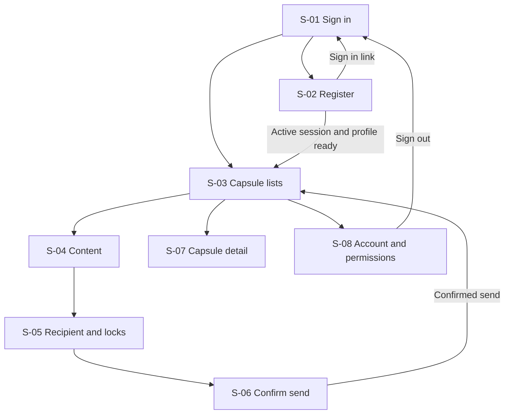

# TimeCapsule design

TimeCapsule lets a signed-in user send a text/photo capsule to themselves or another registered user. The recipient can see its title and lock condition while the message is locked, then keep access after a valid online unlock.

This guide covers screens, navigation, and visual design. Detailed behavior and source records are in [CURRENT_CONTRACT.md](docs/agent-tools/CURRENT_CONTRACT.md) and [SOURCE_REGISTER.md](docs/agent-tools/SOURCE_REGISTER.md). Sections marked **Proposed** contain UI choices that the team must review before adopting them.

## 1. Product and platform

The MVP includes accounts, self-send and delivery to another user, text and/or one original JPEG/PNG photo, Time/Location/Both locks, Received/Sent lists, recovery, local notifications, and continued access after unlock.

The approved UI is **Kotlin with native Android Views, XML layouts, and ViewBinding**, following the existing Material 3 visual direction. ViewBinding connects Kotlin to the generated bindings for XML layouts. “Compose” in the S-04 label means writing content, not Jetpack Compose. Issue #25's starter is merged through PRs #27 and #26; keep the [current repository-compatible versions](docs/agent-tools/UI_VIEWS_UPDATE_2026-11-07.md). Its launch evidence covers the starter only. The plain layout placeholders do not establish completed screen navigation, the final Material 3 design, or service integration.

Check eligibility when the app opens, returns to the foreground, opens a capsule, or the user chooses Retry. Notifications follow a confirmed unlock during one of these checks. The design uses no alarms, geofences, boot receivers, periodic polling, background location, or FCM, and makes no exact-time notification promise for a closed app.

## 2. Eight main screens

Use exactly **S-01–S-08**. These are screen labels inside the existing DD-01/DD-07/DD-26–DD-28 design records, not new Atlas node families. The 7 November team screen table refines the existing navigation; the attached images supply visual direction and state variations. Loading, errors, profile repair, send success, and locked/unlocked detail are variants within the eight screens.

| ID / screen | Main content and actions | Required error / locked states | Existing references |
|---|---|---|---|
| **S-01 Sign in** | Email/password authentication; move to registration; successful session opens the active account's lists. | Invalid credentials, expired session, unavailable network/service; no previous account's data. | FR-01, AC-01; DD-19, DD-26 |
| **S-02 Register** | Firebase Authentication email/password account creation, nonblank display name, and confirmation input; offer a Sign in link. Successful active session plus profile enters S-03. Missing-profile repair is a variant here. | Required input, mismatched confirmation, duplicate/failed account creation, and profile-write failure. Retry profile setup after successful Auth without creating a second account; sending waits for the profile. | FR-01; DD-03, DD-19 |
| **S-03 Capsule lists** | Received/Sent tabs, new capsule, refresh, and account menu. Self-send appears in both tabs with one underlying ID. | Empty, loading, failed, stale/cache/offline; time waiting, location waiting, and available states. Locked cards show safe metadata only. | FR-03, FR-11; AC-03, AC-11; DD-07, DD-28 |
| **S-04 Content / Compose** | Message text, select/remove one photo, Next. Preserve the existing optional title and explain that it is visible while locked. | No text/photo, title-only content, zero-byte or over-5-MiB file, unsupported JPEG/PNG format, and read failure. Keep other valid input. | FR-02, FR-04; AC-02; DD-04, DD-25, DD-27 |
| **S-05 Recipient and locks** | Self or exact UID recipient code with name confirmation; Time/Location/Both; future date/time; confirmed Google Maps point or current location. | Unknown recipient vs unavailable/denied lookup; no lock; current/past time; missing map confirmation; permission/service/location errors. Editing UID clears identity confirmation. | FR-03, FR-05, FR-06, FR-07; DD-03, DD-12, DD-13, DD-22 |
| **S-06 Confirm send** | Summarize content, recipient, title disclosure, and exact conditions; Send or Back to edit while still a draft. Confirmed success leads to Sent. | Disable duplicate Send and edits during sending/unknown outcome. Explain upload failure, definite rejection, and uncertain server result. Check/retry the same frozen operation with the same `capsuleId`; no new-ID editable replacement while uncertain. | AC-02, AC-03, AC-10, AC-14; DD-14, DD-15, DD-21, DD-27 |
| **S-07 Capsule detail** | Locked recipient view shows metadata only. After authorized unlock, show text/photo and permanent re-view. Offer current-condition verification. A→B sender's own-content view is an explicit variant. | Time/location waiting; verification needs internet, permission, or a fresh usable location; denied access; post-unlock photo-loading failure. Sender copy never unlocks B; self-send stays locked in both tabs until recipient authorization. | FR-08, FR-09, FR-12; AC-04–AC-10; DD-06, DD-08, DD-18, DD-28 |
| **S-08 Account and permissions** | Show/copy own recipient code, maintain own display name, sign out, and explain permissions/services. | Notification denial does not block in-app reading. Location denial keeps affected location unlock pending. Logout/switch clears protected state before another session starts. | FR-01, FR-10; NFR-02, NFR-05; DD-19, DD-24, DD-26 |

A successful registration may already establish a signed-in Firebase session. Once its profile is ready, continue to S-03 without forcing another sign-in; the Sign in link remains optional navigation.

Notification entry checks the session and access, then routes to S-07; it is not a ninth main screen. Profile repair stays in S-02. Send progress, unknown outcome, definite failure, and success stay in S-06. The sender-copy and recipient-locked/unlocked variations stay in S-07.

### Create a capsule

Creation uses **three screens: S-04 → S-05 → S-06**. Keep the four logical checks—content, recipient, lock, and review—within this flow. Recipient and lock are two sections of S-05, not separate main screens. Use a three-position progress indicator matching those screens and preserve editable input on Back/Next.

| Screen / section | Required behavior | Contract |
|---|---|---|
| S-04 Content | Optional title, message, one photo and preview. Explain that the title is visible while locked. Require nonblank text and/or one original JPEG/PNG of 1–5,242,880 bytes; a title alone is insufficient. | DD-04, DD-25, DD-27 |
| S-05 Recipient | Choose Me or enter another user's exact UID. Show the returned display name and ask for confirmation. Editing the UID clears confirmation. Distinguish an absent code from failed lookup; do not offer a user directory. | DD-03, DD-19 |
| S-05 Lock | Choose Time, Location, or Both. Show zone/offset and a confirmed map pin or current position. Manual pin selection works without location permission. Show the fixed 150 m radius. Current unlock checks require age ≤60 s and reported accuracy ≤100 m. | DD-05, DD-12, DD-13, DD-22 |
| S-06 Review | Show recipient code/name, title disclosure, content, and exact conditions. Send validates the draft and freezes one capsule ID plus an unchangeable content/settings snapshot. Backend time remains authoritative. | DD-14, DD-15, DD-27 |

**Proposed Back behavior:** move to the previous screen while the draft is editable. On leaving with unsent edits, offer a simple keep/discard choice that matches implemented draft retention. Do not promise recovery after process death unless supported. During sending or an unknown outcome, Back may leave the screen but must not turn the operation into an editable draft.

| Send state in S-06 | Allowed action | Required boundary |
|---|---|---|
| DRAFT | Edit, validate, and send. | Freeze the operation before network work begins. |
| SENDING / OUTCOME_UNKNOWN | Show progress or offer Check status. | Keep the same ID and contents; disable edits and duplicate sends. Leaving the screen does not abandon the operation. |
| Definite unpublished failure | Retry unchanged, or abandon and create an edited new draft. | Retry keeps the original ID and contents. An edited new draft needs a new ID. An absent server read alone does not prove failure. |
| Confirmed success | Open S-03 Sent or the appropriate S-07 detail variant. | For self-send, clear the creation screen's raw content and show the locked recipient view. |

These states follow DD-02, DD-15, and DD-21. The images' mock map, simulated delivery/time/location text, sample accounts, and demo entry are prototype annotations; production behavior must use the approved real adapters. A screenshot's character counter or password hint does not introduce a new validation threshold.

### Explain locked and unavailable states

Use one clear explanation and a relevant next action. These are **proposed English UI strings**:

| Situation | Wording | Action |
|---|---|---|
| Time not reached | “This capsule opens after [date, time, zone].” | Retry when appropriate |
| Outside the location | “You are not within the required location yet.” | Check again |
| Location cannot be verified | “We could not confirm your current location.” | Retry / location settings |
| Offline first unlock | “Connect to check whether this capsule can open.” | Retry online |
| Notifications denied | “You can still open eligible capsules in the app.” | Optional notification settings |
| Unlocked photo missing locally | “This photo is not available offline.” | Download again when online |
| Send outcome unknown | “We could not confirm whether this capsule was sent.” | Check status |

Keep backend terms such as transactions, digests, and session generations in developer guidance rather than user-facing messages.

## 3. Material 3 design system

### Visual identity

The current **DD-01** record in the TimeCapsule Atlas (revision 55, inspected 10 November 2026) retains the original cream `#FBF9F5`, terracotta `#A95640`, sage `#F0F3E9`, ink `#343C37` and border `#E7E5DC` values, with Instrument Serif headings and DM Sans body text. The supplied October 14 prototype PNGs show a related but visibly softer, less saturated visual treatment. The following **screenshot-aligned values are a proposed visual revision for team review**, not an already-approved replacement of DD-01. These are frequent exact pixels sampled from rendered PNGs, not verified CSS variables; confirm the original TypeScript/CSS tokens before treating them as final design-system constants.

| Role | Current DD-01 | Screenshot sample | Intended use |
|---|---|---|---|
| Main background | `#FBF9F5` | `#F9F8F4` | Warm off-white page background |
| Primary accent | `#A95640` | `#865B4B` | Muted brown primary actions, active tabs and emphasis |
| Main text | `#343C37` | `#3D3933` | Dark warm-neutral headings and body |
| Card surface | White | `#FFFDF9` | Rounded content cards, inputs and sheets |
| Muted surface | Sage `#F0F3E9` | `#ECE8DF` | Subtle selected segments, information panels and secondary surfaces |
| Border | `#E7E5DC` | `#E8E3DA` | Quiet separators and card outlines, not the only meaningful control outline |
| Opened state | No separate token | `#E6EBD9` | Soft green confirmed-opened indicator only |
| Error background | No separate token | `#F7EAE4` | Gentle red-tinted field feedback together with explanatory text |

The prototype also uses restrained thin-line icons, subtle pill filters, outlined input controls, generous whitespace, small tracked uppercase eyebrow labels, and a fixed bottom tab bar. Its bottom labels read **Moments / Create / Account**; the existing DD-01/DD-07 wording uses **Capsules / Create / Account**. "Moments" is a proposed display label for the same capsule-list destination, not a newly approved navigation change. Preserve the existing S-01–S-08 screen IDs and destinations.

The PNG set visually documents S-03 Received/Sent, S-04 photo validation, S-05 recipient and Time/Place/Both variants, S-06 review/send outcome, S-07 sender/locked/opened details, and S-08 account/permissions. S-01/S-02 visual references are not included in this supplied set; do not invent their precise appearance. These screenshots were supplied in the project conversation and are **not bundled in this repository**. The source TypeScript/CSS is also not present in the checked-in `prototype/` directory, so exact font-family and spacing values require a separate source review.

### Proposed theme mapping

Use the existing native Views Material 3-compatible theme (the current starter uses `Theme.Material3.DayNight.NoActionBar`) and map the screenshot-aligned tokens through shared Android color/style resources **after design approval**. Do not change dependencies or create a parallel UI framework. The [Material Components guide](https://github.com/material-components/material-components-android/blob/master/docs/getting-started.md) explains Views theming.

| Role | Proposed mapping | Use |
|---|---|---|
| Primary / on-primary | Muted brown `#865B4B` / white `#FFFFFF` | Main action buttons and selected controls |
| Background / on-background | Cream `#F9F8F4` / ink `#3D3933` | Main screens |
| Surface / on-surface | `#FFFDF9` / ink `#3D3933` | Cards, fields and sheets |
| Secondary container / text | `#ECE8DF` / ink `#3D3933` | Secondary information and selection surfaces |
| Opened indicator | `#E6EBD9` with a readable dark label | Confirmed-opened state only |
| Decorative divider | `#E8E3DA` | Nonessential borders and separators |
| Input outline / focus | Readable neutral outline / muted brown | Visible field edges and keyboard focus; confirm final neutral outline on a device |
| Error | `#F7EAE4` surface plus `#B3261E` proposed error text/icon | Inline explanation, never color-only feedback |

Contrast from the sampled swatches is approximately 10.79:1 for ink on cream, 11.29:1 for ink on the card surface, 9.38:1 for ink on the muted surface, and 5.81:1 for white on muted brown. The pale border on the card surface is about 1.26:1 and **cannot be the sole indicator** for a required input or selected control. Check disabled states, opacity, focus outlines and actual device rendering. The screenshots show a light visual treatment only; a corresponding dark theme is not approved merely because the current theme parent supports DayNight.

### Proposed typography and spacing

DD-01 currently assigns **Instrument Serif to headings** and **DM Sans to body text**. The screenshot rendering appears primarily sans-serif for ordinary page headings and uses more expressive italic lettering for sentimental sign-offs. The PNGs do not prove the exact font names. **Proposed adjustment for team review:** use a clean sans-serif display hierarchy for functional headings and reserve serif/italic accents for decorative letter content, subject to verifying the original CSS/fonts. Do not represent this suggested adjustment as an approved font-family change until DD-01 is reconciled.

| Use | Proposed treatment | Proposed size / line height |
|---|---|---|
| Page heading | Clear, warm dark sans-serif display; exact font pending source check | 28 sp / 34 sp |
| Section heading | DM Sans, medium | 20 sp / 28 sp |
| Card title | DM Sans, medium | 18 sp / 24 sp |
| Body / field input | DM Sans | 16 sp / 24 sp |
| Button / key label | DM Sans, medium | 14 sp / 20 sp |
| Supporting text / status | DM Sans | 14 sp / 20 sp |
| Eyebrow / small noncritical caption | Uppercase or tracked DM Sans where appropriate | 12 sp / 16 sp |
| Decorative letter sign-off | Italic serif accent only when appropriate, not a functional label | Reviewed per component |

Allow wrapping and system text scaling. Provide a Korean fallback and record bundled font sources/licenses in the implementing PR. Never shrink important errors or actions to fit a fixed box.

Retain the proposed 4 dp spacing base, with 8 dp between related controls, 16 dp for page/card padding and 24 dp between sections. Cards may use a proposed 16 dp corner radius; match screenshot proportions after checking on Android. Keep touch targets at least 48 × 48 dp and scroll content under the keyboard and system insets.

### Proposed native components

| Purpose | Views component | Interaction |
|---|---|---|
| Main navigation | BottomNavigationView or existing equivalent | Capsule list / Create / Account; screenshot label "Moments" pending approval |
| Received / Sent | TabLayout or existing labeled tabs | Active underline, separate lists; one ID for a self-send |
| Capsule card | MaterialCardView | Warm card surface, subtle border, readable lock/status and safe metadata |
| Status chip | Text/icon in an accessible labeled container | "Sealed" and "Opened" are display copy, not proof of remote authorization |
| Text fields | TextInputLayout + appropriate EditText | Persistent labels, outlined surface, exact-code error and confirmation states |
| Actions | MaterialButton styles | Muted-brown primary action, outlined secondary action; prevent duplicate work |
| Me/Other, Time/Location/Both | Labeled radio group or compatible segmented control | Clear selected state; maintain explicit UID confirmation |
| Date and time | Compatible native/Material picker | Show zone/offset; server requires unlock time strictly later than request time |
| Map target | Google Maps native view/fragment | Replace prototype's mock map; explicit target confirmation and current-position action |
| Creation progress | Three-position labeled step indicator | S-04 Content → S-05 Recipient and locks → S-06 Review; four logical checks remain inside these screens |
| Busy state | Progress indicator + text | Show the actual operation and disable duplicate actions |
| Permission/recovery | Inline explanation; dialog when needed | Relevant Retry/Settings; outcome unknown stays unknown |
| Notification | Generic local notification | No message/photo preview; check access on entry |

Keep S-04 photo-only/text-only validation, title-visible-while-locked disclosure, S-05 exact UID and current-condition semantics, and S-06 frozen-send and reconciliation behavior unchanged. The PNGs' mock map, example UIDs such as `TC-JAMIE1`, sample timestamps, simulated send/unlock text and demo permission toggles **are reference visuals only**, not actual accounts, Firebase UID formats, map implementations or acceptance tests. For S-05 the screenshot's "Found Jamie" presentation alone does not replace the required explicit recipient confirmation. For S-06 a simulated success must never appear as a real backend-acknowledged send.

Use compatible existing components instead of adding a custom widget for each ordinary control. The screenshot-aligned tokens, font assignment and "Moments" label require design review and later DD-01/DD-07 reconciliation; the existing behavior, eight screens, three creation screens and implementation gates do not change in this documentation proposal.

## 4. Data and access rules for screens

The UI reflects the repository's result; a screen state cannot grant access. Follow ARC-01–ARC-07 and the detailed contract for implementation.

| Responsibility | Owner | Screen behavior |
|---|---|---|
| Draft and input state | UI / ViewModel | Validate input and show the frozen send operation. |
| Session, recipient lookup, send/recovery, lists, unlock, content | CapsuleRepository | Handle success, invalid input, denied access, unavailable service, and unknown outcomes for the active account. |
| Account/time authorization and remote state | Firebase rules/operations | Wait for online confirmation; a local pending write is insufficient. |
| Current location | Location adapter + pure evaluator | Use a fresh valid sample, not a remembered visit. |
| Photo selection/upload | Media adapter | Use a bounded original private copy and wait for required upload acknowledgment. |
| Offline re-view | UID-private files and saved unlock records | Require the active UID, a server-confirmed unlock record, and the actual retained bytes. |
| Notifications | Notification adapter | Make one best-effort attempt after confirmed first unlock. |

Keep access and content-loading states separate. An unlocked capsule stays unlocked if its photo is unavailable offline. An unknown send result is neither confirmed success nor definite failure.

| Viewer | A→B content before B unlocks | Self-send content before unlock |
|---|---|---|
| Sender A | Allowed through sender permission | Denied |
| Intended recipient | Denied | Denied |
| Unrelated account / signed out | Denied | Denied |

After confirmed recipient unlock, access remains available even after leaving the location. Offline reading also needs the retained authorized content. A combined lock requires time and fresh location to qualify in the same online attempt.

## 5. Accessibility and review

Use DD-01 and AC-10 when reviewing a screen:

- Keep screens usable with the keyboard and system bars; Send and Retry must remain reachable.
- Give controls at least 48 dp touch targets and meaningful accessible labels.
- Support larger system text without clipping UIDs, headings, errors, or actions.
- Explain states with words/icons as well as color.
- Focus the invalid field and preserve unrelated valid draft input.
- Let long titles, emails, and UIDs wrap; provide Copy where useful.
- Give loading, empty, failed, and unavailable states a clear next step.
- Keep any wireframe simulation controls visibly marked as demos and out of production actions.

Use the [Android Views accessibility guide](https://developer.android.com/guide/topics/ui/accessibility/views/apps-views) and [JOURNEYS.md](docs/agent-tools/JOURNEYS.md) for practical checks. A UI PR should include screenshots, affected source IDs, expected behavior, and actual verification. Review appearance separately from server authorization, location checks, and account isolation.

User F coordinates screen wording and visual design, User G checks navigation and contract consistency, and User J checks implementation and data boundaries. Another teammate reviews each change. All three should be able to explain the user action, screen state, repository call, access rule, failure path, and how the behavior was checked.
