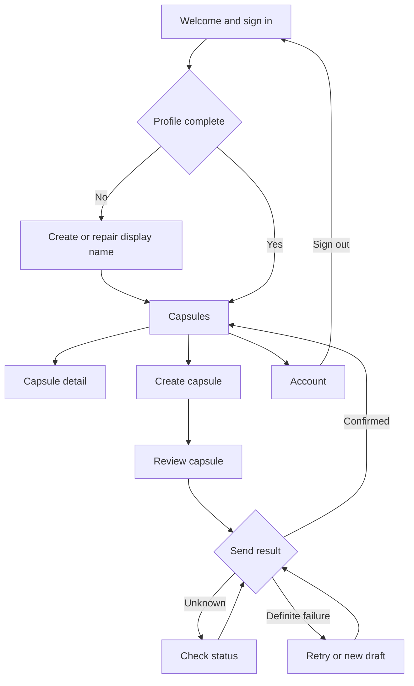

# TimeCapsule design

TimeCapsule lets a signed-in user send a text/photo capsule to themselves or another registered user. The recipient can see its title and lock condition while the message is locked, then keep access after a valid online unlock.

This guide covers screens, navigation, and visual design. Detailed behavior and source records are in [CURRENT_CONTRACT.md](docs/agent-tools/CURRENT_CONTRACT.md) and [SOURCE_REGISTER.md](docs/agent-tools/SOURCE_REGISTER.md). Sections marked **Proposed** contain UI choices that the team must review before adopting them.

## 1. Product and platform

The MVP includes accounts, self-send and delivery to another user, text and/or one original JPEG/PNG photo, Time/Location/Both locks, Received/Sent lists, recovery, local notifications, and continued access after unlock.

The approved target is **Kotlin with native Android Views and Material 3**. The repository contains a provisional Compose scaffold; resolve that difference in a separate reviewed UI task before expanding it. See [REPOSITORY_STATUS.md](docs/agent-tools/REPOSITORY_STATUS.md).

Check eligibility when the app opens, returns to the foreground, opens a capsule, or the user chooses Retry. Notifications follow a confirmed unlock during one of these checks. The design uses no alarms, geofences, boot receivers, periodic polling, background location, or FCM, and makes no exact-time notification promise for a closed app.

## 2. Screens and navigation

The screen flow follows DD-07 and DD-26–DD-28:

| Screen | What the user sees and does | Key behavior | Contract |
|---|---|---|---|
| Welcome / Sign in | Register or sign in with email and password. | Distinguish invalid credentials from an unavailable service. Load only the active account's screens and data. | FR-01; DD-19, DD-26 |
| Registration / Profile repair | Enter a nonblank display name. | Create the profile for the authenticated UID. Retry a failed profile write without creating another Auth account. Sending stays disabled until the profile exists. | DD-03, DD-19 |
| Capsules | Switch between Received and Sent; open a capsule; navigate to Create or Account. | Show title, participant, lock condition, and accurate loading/empty/error/stale states. Refresh finds new receipts. A self-send appears in both lists with one capsule ID. | FR-11; DD-07, DD-28 |
| Create | Complete Content → Recipient → Lock → Review. | Preserve editable input between steps and validate before Send. See the creation rules below. | FR-02–FR-07; DD-27 |
| Capsule detail | Read safe information while locked, then authorized text/photo after unlock. | Hide message and photo previews while locked. Explain verification failures and missing offline assets separately. | FR-08–FR-12; DD-06, DD-08, DD-18, DD-28 |
| Account | Copy the user's UID, edit their display name, or sign out. | Clear old account screens and protected content on sign-out; late callbacks must not restore them. | FR-01; DD-19, DD-26 |
| Notification entry | Open a generic capsule-ready notification. | Check authentication and capsule access before displaying content. A notification never grants access by itself. | FR-10; DD-09, DD-24 |

### Create a capsule

The four steps have a visible step label and clear Next/Back controls. Forward navigation must not bypass validation.

| Step | Required behavior | Contract |
|---|---|---|
| Content | Allow optional title, message, and one photo with a preview. Explain that the title is visible while locked. Require nonblank text and/or a supported photo; a title alone is insufficient. | DD-04, DD-27 |
| Recipient | Choose Me or enter another user's exact UID, their account code. Show the returned display name and ask for confirmation. Editing the UID clears that confirmation. Distinguish an unknown code from a failed lookup. Do not offer a user directory. | DD-03, DD-19 |
| Lock | Choose Time, Location, or Both. Show the time zone and a confirmed map pin or current position. Manual pin selection works without location permission; current-position use handles permission/settings errors. Display the fixed 150 m radius. | DD-12, DD-13, DD-22 |
| Review | Show recipient code/name, title disclosure, content, and the exact lock condition. Send validates the draft and freezes one capsule ID and an unchangeable copy of its contents and settings. | DD-14, DD-15, DD-27 |

**Proposed Back behavior:** move to the previous step while the draft is editable. On leaving with unsent edits, offer a simple keep/discard choice that matches the implemented draft retention. Do not promise recovery after process death unless supported. During sending or an unknown outcome, Back may leave the screen but must not turn the operation into an editable draft.

| Send state | Allowed action | Required boundary |
|---|---|---|
| DRAFT | Edit, validate, and send. | Freeze the operation before network work begins. |
| SENDING / OUTCOME_UNKNOWN | Show progress or offer Check status. | Keep the same ID and contents; disable edits and duplicate sends. Leaving the screen does not abandon the operation. |
| Definite unpublished failure | Retry unchanged, or abandon and create an edited new draft. | Retry keeps the original ID and contents. An edited new draft needs a new ID. An absent server read alone does not prove failure. |
| Confirmed success | Open Sent or the appropriate detail view. | For self-send, clear the creation screen's raw content and show the locked recipient view. |

These states follow DD-02, DD-15, and DD-21. Sender access to an A→B capsule does not give its recipient early access.

### Explain locked and unavailable states

Use one clear explanation and a relevant next action. These are **proposed English UI strings**:

| Situation | Wording | Action |
|---|---|---|
| Time not reached | “This capsule opens after [date, time, zone].” | Retry when appropriate |
| Outside the location | “You are not within the required location yet.” | Check again |
| Location cannot be verified | “We could not confirm your current location.” | Retry / location settings |
| Offline first unlock | “Connect to check whether this capsule can open.” | Retry online |
| Notifications denied | “You can still open eligible capsules in the app.” | Optional notification settings |
| Unlocked photo missing locally | “This photo is not available offline.” | Download again when online |
| Send outcome unknown | “We could not confirm whether this capsule was sent.” | Check status |

Keep backend terms such as transactions, digests, and session generations in developer guidance rather than user-facing messages.

## 3. Material 3 design system

### Visual identity

DD-01 defines these shared values:

| Token | Value | Use |
|---|---|---|
| Warm cream | `#FBF9F5` | Main background |
| Terracotta | `#A95640` | Primary accent |
| Sage | `#F0F3E9` | Supporting surfaces |
| Dark ink | `#343C37` | Main text |
| Pale border | `#E7E5DC` | Decorative separation |
| Cards | White, rounded | Content groups |
| Headings | Instrument Serif | Page and display headings |
| Body | DM Sans | Text, controls, and supporting copy |
| Touch targets | At least 48 × 48 dp | Interactive controls |

### Proposed theme mapping

Use one shared Material 3 theme for native Views, such as a compatible `Theme.Material3.Light.NoActionBar` theme. Prefer existing compatible components and preserve dependency pins unless a reviewed change requires an update. The [Material Components guide](https://github.com/material-components/material-components-android/blob/master/docs/getting-started.md) explains Views themes.

| Role | Proposed mapping | Use |
|---|---|---|
| Primary / on-primary | Terracotta / white `#FFFFFF` | Main action buttons |
| Background / on-background | Cream / ink | Main screen |
| Surface / on-surface | White / ink | Cards, fields, sheets |
| Supporting container / text | Sage / ink | Secondary groups |
| Decorative divider | Pale border | Nonessential separation |
| Input outline / focus | `#747C75` / terracotta | Visible field edges and focus |
| Error | `#B3261E` with text/icon | Readable error feedback |

The outline and error colors are proposals, not confirmed DD-01 tokens. Review the mapping against the app's resources. Keep the shared palette consistent; dynamic color or dark mode needs a complete reviewed theme rather than an automatic override.

Calculated contrast is approximately 10.81:1 for ink on cream, 11.37:1 for ink on white, 10.12:1 for ink on sage, and 5.13:1 for white on terracotta. Pale border on white is only about 1.26:1, so use stronger outlines for meaningful controls. Check actual disabled states, opacity, overlays, and text rendering on a device.

### Proposed typography and spacing

Keep the confirmed font families and use shared text styles and dimensions. The [Views typography guide](https://github.com/material-components/material-components-android/blob/master/docs/theming/Typography.md) explains reusable theme attributes.

| Use | Family | Proposed size / line height |
|---|---|---|
| Page heading | Instrument Serif | 28 sp / 34 sp |
| Section heading | DM Sans, medium | 20 sp / 28 sp |
| Card title | DM Sans, medium | 18 sp / 24 sp |
| Body / field input | DM Sans | 16 sp / 24 sp |
| Button / key label | DM Sans, medium | 14 sp / 20 sp |
| Supporting text / status | DM Sans | 14 sp / 20 sp |
| Small noncritical caption | DM Sans | 12 sp / 16 sp |

Allow wrapping and system text scaling. Provide a font fallback for unsupported characters, including Korean, and record bundled font sources/licenses in the implementing PR. Never shrink an important error or action to fit a fixed box.

Use a proposed 4 dp spacing base: 8 dp between related controls, 16 dp for page/card padding, and 24 dp between sections. Cards use a proposed 16 dp corner radius. Keep touch targets at least 48 × 48 dp and allow content to scroll.

### Proposed native components

| Purpose | Views component | Interaction |
|---|---|---|
| Main navigation | BottomNavigationView or existing equivalent | Capsules / Create / Account, with labels |
| Received / Sent | TabLayout or existing labeled tabs | Separate lists; one ID for a self-send |
| Capsule card | MaterialCardView | Safe metadata and readable state |
| Text fields | TextInputLayout + appropriate EditText | Persistent labels, correct input type, inline errors |
| Actions | MaterialButton styles | One primary action per step; prevent duplicate work |
| Me/Other, Time/Location/Both | Labeled radio group or compatible segmented control | Clear single selection |
| Date and time | Compatible native/Material picker | Show zone/offset; server requires an unlock time strictly later than its request time |
| Map target | Google Maps native view/fragment | Explicit pin confirmation; separate current-position action |
| Creation progress | Labeled step indicator | Announce the step; enforce validation |
| Busy state | Progress indicator + text | Explain what is happening |
| Permission/recovery | Inline explanation; dialog when needed | Relevant Retry/Settings action |
| Notification | Generic local notification | No message/photo preview; check access on entry |

Use compatible existing components instead of adding a custom widget for each ordinary control.

## 4. Data and access rules for screens

The UI reflects the repository's result; a screen state cannot grant access. Follow ARC-01–ARC-07 and the detailed contract for implementation.

| Responsibility | Owner | Screen behavior |
|---|---|---|
| Draft and input state | UI / ViewModel | Validate input and show the frozen send operation. |
| Session, recipient lookup, send/recovery, lists, unlock, content | CapsuleRepository | Handle success, invalid input, denied access, unavailable service, and unknown outcomes for the active account. |
| Account/time authorization and remote state | Firebase rules/operations | Wait for online confirmation; a local pending write is insufficient. |
| Current location | Location adapter + pure evaluator | Use a fresh valid sample, not a remembered visit. |
| Photo selection/upload | Media adapter | Use a bounded original private copy and wait for required upload acknowledgment. |
| Offline re-view | UID-private files and saved unlock records | Require the active UID, a server-confirmed unlock record, and the actual retained bytes. |
| Notifications | Notification adapter | Make one best-effort attempt after confirmed first unlock. |

Keep access and content-loading states separate. An unlocked capsule stays unlocked if its photo is unavailable offline. An unknown send result is neither confirmed success nor definite failure.

| Viewer | A→B content before B unlocks | Self-send content before unlock |
|---|---|---|
| Sender A | Allowed through sender permission | Denied |
| Intended recipient | Denied | Denied |
| Unrelated account / signed out | Denied | Denied |

After confirmed recipient unlock, access remains available even after leaving the location. Offline reading also needs the retained authorized content. A combined lock requires time and fresh location to qualify in the same online attempt.

## 5. Accessibility and review

Use DD-01 and AC-10 when reviewing a screen:

- Keep screens usable with the keyboard and system bars; Send and Retry must remain reachable.
- Give controls at least 48 dp touch targets and meaningful accessible labels.
- Support larger system text without clipping UIDs, headings, errors, or actions.
- Explain states with words/icons as well as color.
- Focus the invalid field and preserve unrelated valid draft input.
- Let long titles, emails, and UIDs wrap; provide Copy where useful.
- Give loading, empty, failed, and unavailable states a clear next step.
- Keep any wireframe simulation controls visibly marked as demos and out of production actions.

Use the [Android Views accessibility guide](https://developer.android.com/guide/topics/ui/accessibility/views/apps-views) and [JOURNEYS.md](docs/agent-tools/JOURNEYS.md) for practical checks. A UI PR should include screenshots, affected source IDs, expected behavior, and actual verification. Review appearance separately from server authorization, location checks, and account isolation.

User F coordinates screen wording and visual design, User G checks navigation and contract consistency, and User J checks implementation and data boundaries. Another teammate reviews each change. All three should be able to explain the user action, screen state, repository call, access rule, failure path, and how the behavior was checked.
