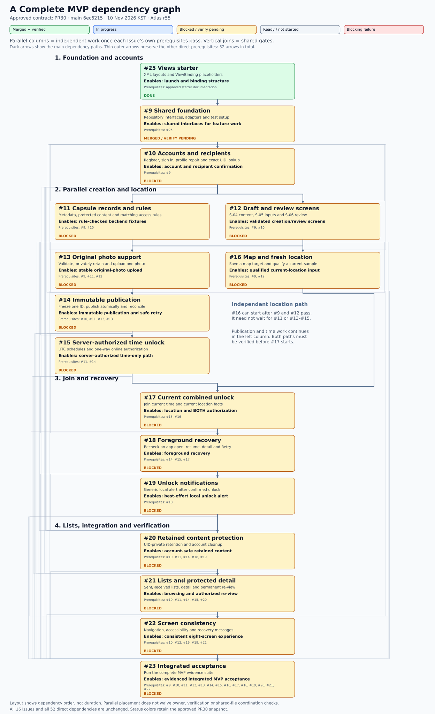
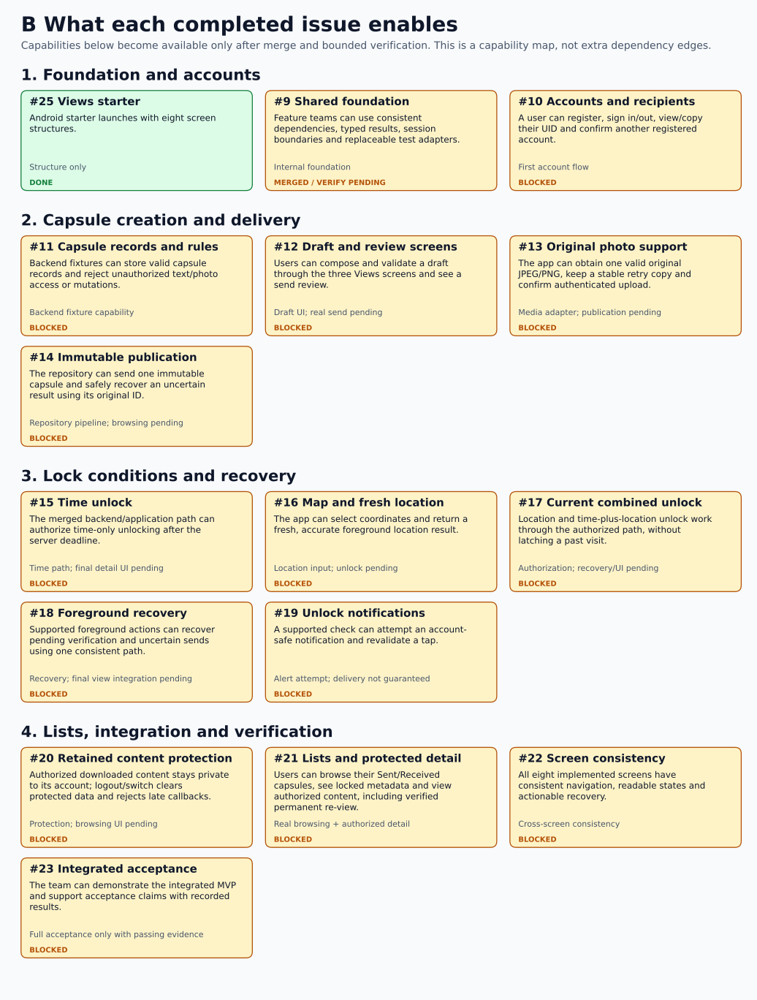
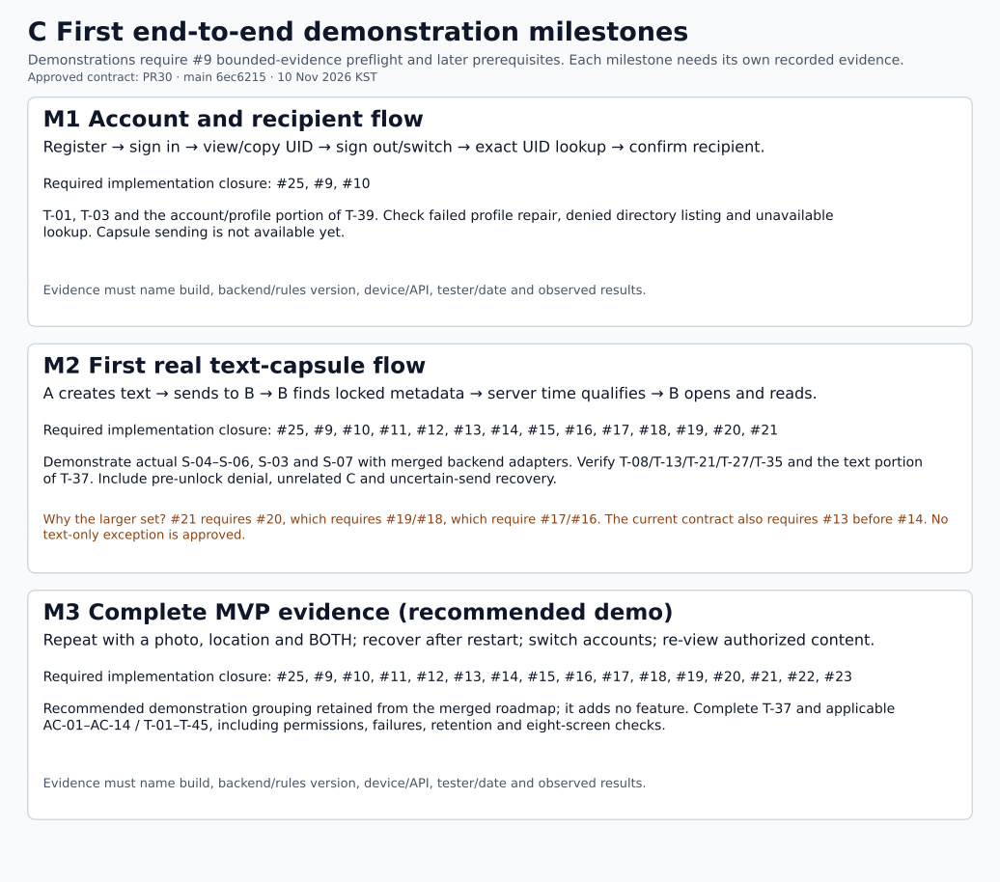

# TimeCapsule implementation roadmap

This roadmap answers what each issue builds, what its completion enables, and why work is blocked. The diagrams are exported from the approved contract in merged [PR #30](https://github.com/theguardianofthebed/Time-Capsule/pull/30), main `6ec6215786447882d9aca2e9e9c18d5d0fd8eda0`. PR #30 adopted the governance documents; it did not verify downstream application features. The snapshot was checked on **10 November 2026 (Asia/Seoul)** against Atlas **r55**, live issue bodies and main `c60d866cdc9794af97db129c946b66711270f6b9`. Recheck before implementation.

**Current position after 00:56 KST on 10 November:** #25 is implemented, merged and verified for its starter boundary. #9 is **MERGED / VERIFICATION PENDING** after the external merge of PR #29. Review applicability of recorded bounded foundation checks and classify the unspecified follow-up. Actual emulator connectivity/rules execution is unrecorded, but full account/capsule rules acceptance remains downstream, not a new #9 gate. #10 remains blocked pending fresh bounded-evidence and owner/reviewer preflight; #11–#23 additionally need unfinished predecessor implementations. No failed application test is inferred from missing evidence.

Green = implemented, merged and verified; blue = in progress; amber = blocked or merged with required verification pending; gray = ready/not started; red = confirmed blocking failure. A PR opened or an issue closed alone is insufficient evidence.

## A. Complete MVP dependency graph

[Open the full-resolution dependency graph](roadmap/A-complete-dependencies.svg). Every arrow is a direct prerequisite, copied from the issue contract.

## B. Issue completion and capabilities

[Open the capability map](roadmap/B-capabilities.svg). Component outcomes remain separate from complete user flows.

## C. First end-to-end milestones

[Open the milestone map](roadmap/C-milestones.svg). Required issue sets include the complete dependency closure.

M1 requires #25, #9 and #10. M2 requires #25 and #9–#21 under the current dependency contract, even though the demonstration uses text and a time lock. This is because list/detail issue #21 depends on retention #20, which depends on notifications/recovery #19/#18, which depends on combined/location #17/#16. The #13 → #14 media prerequisite also remains required. A smaller text-only implementation slice would require an explicit reviewed change to scope and dependencies before coding; this roadmap does not make that change.

M3 is a **recommended final demonstration grouping** because the supplied mission ends during M2 and provides no final M3 definition. It combines the existing approved MVP paths and integrated evidence through #22/#23; it adds no feature.

## Exact issue mapping

**Issue-boundary update (10 November 2026):** #10 supplies the recipient lookup/confirmation API and state, while #12 implements the S-05 confirmation controls. The roadmaps/graphs still encode the same prerequisites and MVP; the user-facing acceptance remains downstream until the S-05 UI is implemented and verified.

| Issue | Bounded deliverable | Completion enables | Direct prerequisites | Observed status |
|---|---|---|---|---|
| [#25](https://github.com/theguardianofthebed/Time-Capsule/issues/25) Views starter | XML layouts and ViewBinding placeholders | Android starter launches with eight screen structures. | Approved starter docs | DONE |
| [#9](https://github.com/theguardianofthebed/Time-Capsule/issues/9) Shared foundation | Repository interfaces, adapters and test setup | Feature teams can use consistent dependencies, typed results, session boundaries and replaceable test adapters. | #25 | MERGED / VERIFICATION PENDING |
| [#10](https://github.com/theguardianofthebed/Time-Capsule/issues/10) Accounts and recipients | Register, sign in/out, profile repair, UID display/copy and exact lookup/**confirmation interface only** | Account flows and exact authenticated lookup/confirmation state become available for S-05 to consume; **no user-facing recipient confirmation UI in #10**. | #9 | DRAFT PR #33; final review pending |
| [#11](https://github.com/theguardianofthebed/Time-Capsule/issues/11) Capsule records and rules | Metadata, protected content and matching access rules | Backend fixtures can store valid capsule records and reject unauthorized text/photo access or mutations. | #9, #10 | BLOCKED |
| [#12](https://github.com/theguardianofthebed/Time-Capsule/issues/12) Draft and review screens | S-04 content, S-05 **recipient-confirmation UI**/locks, S-06 review | Users compose/validate a draft; exact lookup results show UID/name, require explicit confirmation and reset on UID/account edits before proceeding. | #9, #10 | BLOCKED |
| [#13](https://github.com/theguardianofthebed/Time-Capsule/issues/13) Original photo support | Validate, privately retain and upload one photo | The app can obtain one valid original JPEG/PNG, keep a stable retry copy and confirm authenticated upload. | #9, #11, #12 | BLOCKED |
| [#14](https://github.com/theguardianofthebed/Time-Capsule/issues/14) Immutable publication | Freeze one ID, publish atomically and reconcile | The repository can send one immutable capsule and safely recover an uncertain result using its original ID. | #10, #11, #12, #13 | BLOCKED |
| [#15](https://github.com/theguardianofthebed/Time-Capsule/issues/15) Server-authorized time unlock | UTC schedules and one-way online authorization | The merged backend/application path can authorize time-only unlocking after the server deadline. | #11, #14 | BLOCKED |
| [#16](https://github.com/theguardianofthebed/Time-Capsule/issues/16) Map and fresh location | Save a map target and qualify a current sample | The app can select coordinates and return a fresh, accurate foreground location result. | #9, #12 | BLOCKED |
| [#17](https://github.com/theguardianofthebed/Time-Capsule/issues/17) Current combined unlock | Join current time and current location facts | Location and time-plus-location unlock work through the authorized path, without latching a past visit. | #15, #16 | BLOCKED |
| [#18](https://github.com/theguardianofthebed/Time-Capsule/issues/18) Foreground recovery | Recheck on app open, resume, detail and Retry | Supported foreground actions can recover pending verification and uncertain sends using one consistent path. | #14, #15, #17 | BLOCKED |
| [#19](https://github.com/theguardianofthebed/Time-Capsule/issues/19) Unlock notifications | Generic local alert after confirmed unlock | A supported check can attempt an account-safe notification and revalidate a tap. | #18 | BLOCKED |
| [#20](https://github.com/theguardianofthebed/Time-Capsule/issues/20) Retained content protection | UID-private retention and account cleanup | Authorized downloaded content stays private to its account; logout/switch clears protected data and rejects late callbacks. | #10, #11, #14, #18, #19 | BLOCKED |
| [#21](https://github.com/theguardianofthebed/Time-Capsule/issues/21) Lists and protected detail | Sent/Received lists, detail and permanent re-view | Users can browse their Sent/Received capsules, see locked metadata and view authorized content, including verified permanent re-view. | #10, #11, #14, #15, #20 | BLOCKED |
| [#22](https://github.com/theguardianofthebed/Time-Capsule/issues/22) Screen consistency | Navigation, accessibility and recovery messages | All eight implemented screens have consistent navigation, readable states and actionable recovery. | #10, #12, #16, #19, #21 | BLOCKED |
| [#23](https://github.com/theguardianofthebed/Time-Capsule/issues/23) Integrated acceptance | Run the complete MVP evidence suite | The team can demonstrate the integrated MVP and support acceptance claims with recorded results. | #9, #10, #11, #12, #13, #14, #15, #16, #17, #18, #19, #20, #21, #22 | BLOCKED |

## Evidence and ownership

- #25: PR #27 merge `767da71054b968c569c5154724ff8bbc453484ca` is present in main through #26. User G implemented the starter; User J recorded the theme compatibility correction. Recorded evidence includes binding, build, unit tests and emulator launch. These were not rerun for this roadmap. T-45 full behavior remains downstream.
- #9: User J authored the implementation on `feature/9-reviewable`; PR #29 merged implementation head `544f5a673037059f3fb9fc5656e1616caa27748c` as `c60d866cdc9794af97db129c946b66711270f6b9`. The log records 25 unit tests and configuration/cache corrections. The PR description still shows older findings. Actual emulator connectivity/rules execution remains unrecorded; confirm which bounded checks #9 requires without importing downstream account/capsule acceptance. A post-review comment reports an additional problem to be tracked in a new issue, but does not specify the defect, severity or a verification exception ([comment](https://github.com/theguardianofthebed/Time-Capsule/pull/29#issuecomment-6744585480)). Confirm that follow-up scope before relying on the foundation; no specific runtime failure is asserted here. Confirm applicable bounded evidence and run fresh preflight before #10; any correction must use a coordinated follow-up branch, not a competing foundation implementation.
- #10: [Draft PR #33](https://github.com/theguardianofthebed/Time-Capsule/pull/33) records User G's account implementation and User J's emulator verification/corrections; formal issue assignment, independent review, and final merge remain unverified. The explicit 10 November allocation is **#10 = exact recipient lookup/confirmation interface only, #12 = S-05 user-facing confirmation UI**. This supplements the earlier roadmap snapshot; it does not revise Atlas r55, alter dependencies, or claim full AC-03/T-03 acceptance. See [bounded handoff](handoffs/issue-10-recipient-interface-20261110.md).
- #11–#23: ownership/overlap checks must be refreshed before implementation. Record the acting User F/G/J, different human reviewer, actual work period, base commit, branch/PR, file boundary, dependency evidence and remaining work.

All issues are MVP. Dependency windows in [IMPLEMENTATION_ORDER.md](IMPLEMENTATION_ORDER.md) are planning periods, not promised completion dates. WIP is 9–13 November; individual Week 1 logs are due 13 November. These milestones do not authorize bypassing dependencies or claiming a starter as the complete MVP.

The [dependency manifest](dependencies.json) is the machine-readable mapping; [workflow](WORKFLOW.md) defines current readiness evidence. Repository rules and an agent preflight guide behavior. They do not by themselves configure branch protection or prevent arbitrary local editing.
