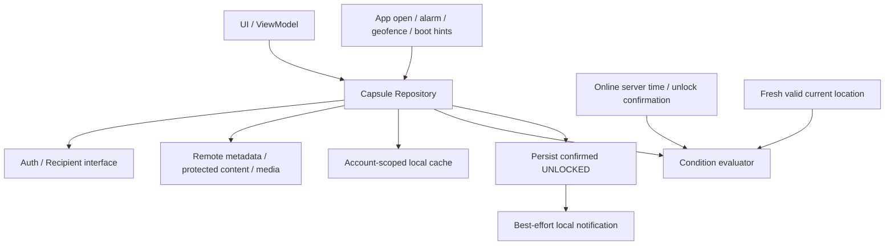

<!-- Notion snapshot: 2026-10-13; source: https://www.notion.so/3edf1c1dcaa38062aeb9c8bdb57c2cff -->
> [Notion source](https://www.notion.so/3edf1c1dcaa38062aeb9c8bdb57c2cff). Draft snapshot, not unanimous approval or implementation evidence. Latest shared discussions remain authoritative for unresolved choices.

# Architecture Draft v0.1
## 상태와 근거 / Status and sources
2026-10-13 건우 초안. 구현/테스트 통과 및 공급자 확정이 아니다. 백엔드 spike 후 준원이 검토·보완한다. 원문·기존 댓글은 유지하고 합의가 필요한 변경은 별도로 표시한다.
[Notion source](https://app.notion.com/p/a2cf1c1dcaa382fea69301a4867e6315)
[Notion source](https://app.notion.com/p/3d1f1c1dcaa3824bbff58133eb53130c)
[Notion source](https://app.notion.com/p/3f4f1c1dcaa3801aa07ff830bb17000a)

English Version

Geonwoo draft; not implementation, test evidence or a finalized provider. Junwon reviews/refines backend design after the spike. Preserve discussions and identify unresolved choices.

## 계층과 책임
- UI/Navigation: 화면 입력·목록·잠김/해제/오류 상태. UI만으로 서버 접근권한을 대신하지 않는다.
- ViewModel: 화면 상태와 한 번의 사용자 작업을 관리. 전송 중 중복 누름 방지, 같은 작업 ID 보존.
- CapsuleRepository: 생성/전송, 보낸·받은 조회, 온라인 최초 해제 요청, 캐시 읽기/복구의 공통 경계.
- Auth/Recipient service: 로그인 세션, 본인 UID, 수신자 확인. 인증 구현·수신 코드 UX는 spike 후 구체화.
- Remote store/media service: 원본·발신자/수신자·전송·해제 상태와 사진 접근권한. 사진 업로드와 메타데이터 확인을 모두 받기 전 Sent 금지.
- ConditionEvaluator: 시간·현재 위치 AND의 순수 판단. 서버에서 확인한 시간/조건과 유효 위치를 입력받는다. 클라이언트 계산만으로 접근권한/최초 해제 성공을 선언하지 않는다.
- Local cache/settings: 이미 받은 목록/해제 콘텐츠와 복구에 필요한 상태. 계정별 분리. Room은 최종 선택 아님; Firebase이면 Firestore 캐시 + 작은 DataStore부터 검토.
- Event/Notification adapters: 알림·geofence·부팅은 재확인 힌트. FCM/주기적 새 수신 동기화/상시 서비스 제외. 위치 백그라운드 등록은 필수 경로가 아닌 선택된 구현의 보조 기능.
## 데이터 흐름

## 중요한 경계
1. 잠긴 목록 메타데이터와 시간 보호 콘텐츠/사진의 접근 경계를 분리한다. 계정 C/로그아웃 접근은 원격 규칙으로 막는다. self-send 예외는 FR-08 토론 결정 후 규칙에 반영.
2. combined 시간 전이면 위치 평가를 미루고 시간 대기를 표시한다. 시간 후 현재 위치를 새로 평가하여 전체 AND를 확인. location-only는 시간 gate 없음.
3. 서버 확인 실패·오프라인·위치 불명은 잠김 유지. UNLOCKED 서버 상태는 단조롭게 유지하며 캐시가 서버 허가를 우회하지 않는다.
4. 전송 실패/결과 불명은 같은 capsuleId로 확인/재시도하는 건우 추천안. 내용 해시로 별도 정상 전송까지 막는 방식은 공동 논의 중.
5. 계정 전환은 이전 계정 화면 데이터·사진 캐시·알림·등록 정리 후 새 계정 동기화.
## Backend spike가 보완할 항목
실제 공급자/사진 비용, 서버 시간·unlock 상태를 안전하게 저장하는 API/규칙, 수신 디렉터리, 사진 업로드/메타데이터의 부분 실패와 복구, A/B/C 권한 검증. 이 항목을 검증 완료로 표시하지 않는다.

English Version

Use UI/ViewModel → repository → auth/recipient, remote store/media, account cache and evaluator interfaces. Persist server-confirmed monotonic UNLOCKED; callbacks are hints and scheduling is separate. Protect account boundaries remotely and separate metadata from time-protected content/media. For combined locks check time first, then fresh current location; location-only has no time gate. Offline/verification failures stay locked. No FCM, periodic receipt sync or always-running service. Cache technology, actual server unlock API/rules, provider/billing and partial-upload recovery await the backend spike. Stable-ID retries and self-send preview remain explicit team discussions.

[Notion source](https://app.notion.com/p/3edf1c1dcaa3809ba11ff3b676c91d2d)
[Notion source](https://app.notion.com/p/3edf1c1dcaa38031b6b8ef106057d537)
## 남은 리뷰 / Remaining review
준원의 기술/백엔드 검토와 Flora의 제품 흐름 확인이 필요하다. 모든 리뷰 LGTM 및 질문 처리 전 In Review 유지.

English Version

Keep In Review until technical/product reviews give LGTM and substantive questions are settled.

